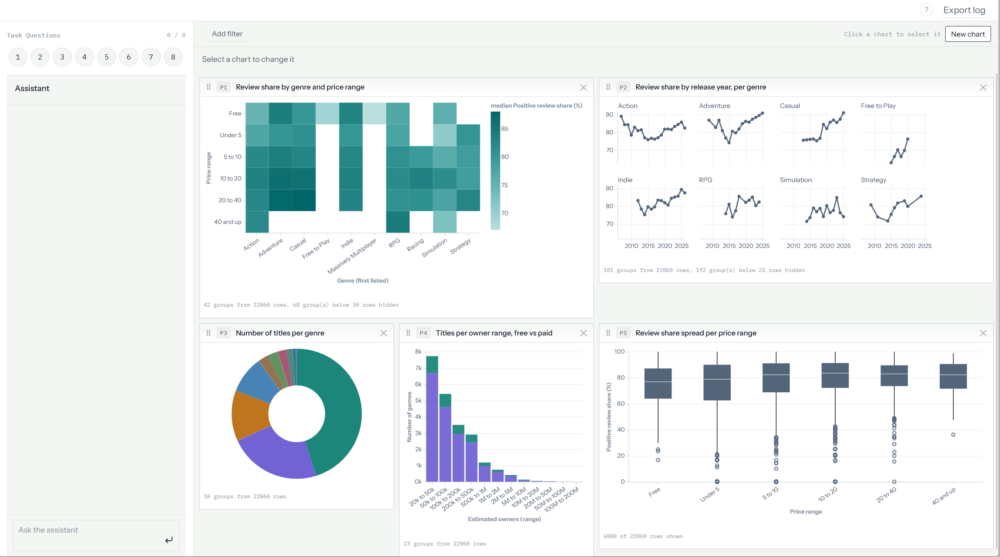
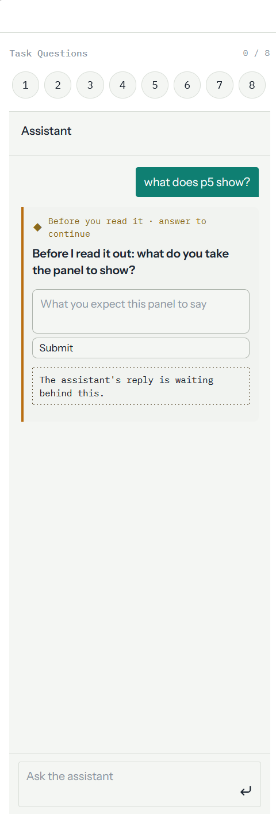
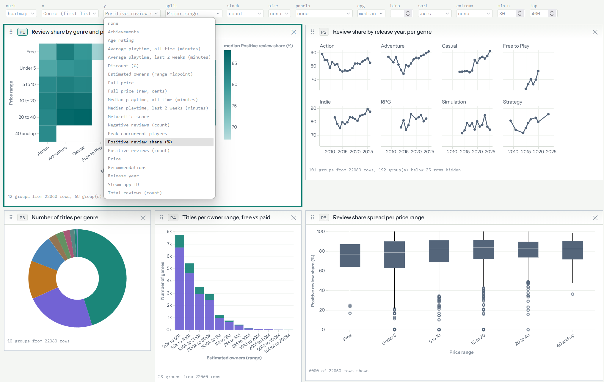

# Think First

**Cognitive forcing functions in AI assisted data exploration**

A research prototype for my bachelor's thesis in human computer interaction at
TU Wien. It combines a visual analytics dashboard with an AI assistant and adds
small interventions at the moments where people take over what the assistant
tells them, instead of checking it against the data.

> **Status: work in progress.** The user study is running; the code will be
> published here once data collection is complete.

## What it does

- **Dashboard:** five linked panels over 22,060 Steam games, with highlighting,
  filters and a chart builder
- **AI assistant:** explains panels, builds charts and helps with the next step
- **Interventions:** short prompts for own thinking at selected moments
- **Logging:** every interaction, for the qualitative analysis

## Screenshots

| | |
|---|---|
|  |  |
| Asked what a panel shows, the assistant first asks for the analyst's own reading | Every panel can be changed from one control row |

## Built with

Python · FastAPI · pandas · Vega-Lite · JavaScript · Anthropic API

Built by me as part of the thesis, with the help of AI coding assistants.